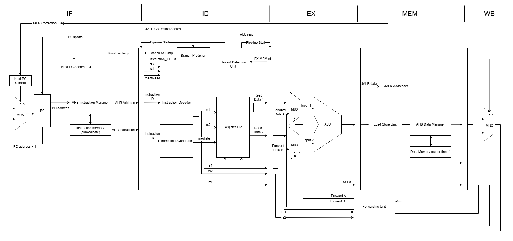
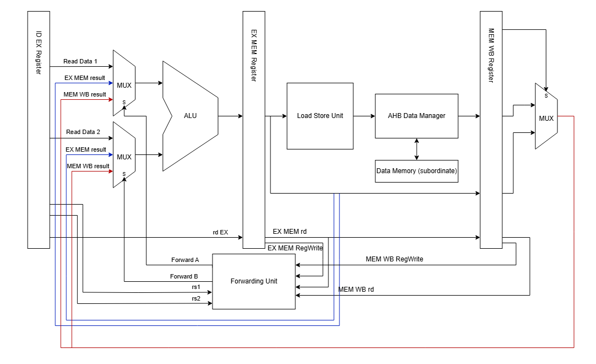

# RV32I 5-Stage Pipelined Processor Core

A 32-bit RISC-V (RV32I) processor core implemented in SystemVerilog and synthesized through the OpenLane physical design flow. The architecture is a standard 5-stage pipeline with branch prediction, data forwarding logic, hazard detection, and two AHB-Lite bus interfaces for separate data and instruction memory. The design is verified using SystemVerilog Assertions (SVA) and a directed testbench that cover edge cases.

## Architectural Highlights

* **ISA Compliance:** RV32I Base Integer Instruction Set with support for byte/halfword load/store memory operations.
* **5-Stage Pipeline Architecture:** Standard **IF** $\rightarrow$ **ID** $\rightarrow$ **EX** $\rightarrow$ **MEM** $\rightarrow$ **WB** pipeline.
* **Dual AHB-Lite Bus Interfaces (Harvard Architecture):**
  * **I-AHB Master:** Instruction memory bus utilizing the pipelined address/data phase to achieve 1 instruction per cycle.
  * **D-AHB Master:** Data memory bus utilizing the pipelined address/data phase to handle transfers for the data given by the Load-Store unit.
* **Branch Prediction:** 
  * 2-Bit Saturating Counter branch prediction (`Strongly Not Taken` $\leftrightarrow$ `Strongly Taken`).
  * No misprediction penalty for correctly predicted branches.
  * Automatic pipeline flushes on mispredictions with a two-cycle penalty.
* **Hazard Handling:**
  * **Data Forwarding Unit:** Resolves Read-After-Write (RAW) data hazards (EX $\rightarrow$ EX, MEM $\rightarrow$ EX).
  * **Hazard Detection Unit:** Identifies non-forwardable Load-Use dependencies and injects hardware stalls.
  * **X0 Register Guarding:** Suppresses writes to `x0` to maintain the zero register. 

## System Architecture

### 1. 5-Stage Core Overview


*Figure 1: RV32I 5-stage pipelined datapath featuring branch prediction, hazard handling, and AHB-Lite bus interfaces.*

* **Pipelined Datapath:** Standard 5-stage pipeline (`IF`, `ID`, `EX`, `MEM`, `WB`).
* **AHB-Lite Bus Interfaces:** Independent Instruction and Data AHB-Lite managers.
* **Decoupled Control Paths:** Separates datapath execution from local control hazard evaluation.

### 2. Branch & Jump Control Logic


*Figure 2: Branch prediction and JALR target resolution paths.*

* **2-Bit Branch Predictor:** Operates in the `IF/ID` stages using a saturating counter state machine to minimize branch penalty on correct predictions.
* **Resolution Paths:**
  * **Branch Target (EX Stage):** Evaluated in `EX` to correct branch mispredictions and limit branch misprediction penalties to 2 cycles.
  * **JALR Target (EX Stage):** Evaluated using forwarded ALU results and bit-masking before driving target selection based on correction multiplexers.

### 3. Hazard Detection & Forwarding Unit


*Figure 3: Execution stage forwarding matrix for RAW data dependencies.*

* **ALU Forwarding:** Forwards data from `EX/MEM` and `MEM/WB` pipeline registers back to the ALU input MUXes (`Forward A/B`).
* **Load-Use Stalls:** Intercepts `Load-Use` hazards by monitoring `ID/EX.MemRead` and instruction opcodes to stretch pipeline holds across multi-cycle bus transactions.

## Hardware Modules

| Module Name | Description |
| :--- | :--- |
| RV32I_subsystem | Top-level module connecting the RV32I core with the AHB-Lite bus adapters for instruction and data memory. |
| Core | Implements pipeline stages, hazard control, and branch prediction. |
| HazardDetection | Detects load-use hazards and manages pipeline stalls and bubble inserts. |
| ForwardingUnit | Determines which operand source is used for the execution stage from the register file, EX/MEM, or MEM/WB stages. |
| BranchPredictor | 2-bit saturation counter for branch prediction and execution stage branch correction for mispredictions. |
| AHBDataManager | Controls 2-cycle AHB-Lite transactions for data memory load and stores. | 
| AHBInstructionManager | Controls 2-cycle AHB-Lite transactions for instruction fetches. |
| XALU | Execution ALU supporting full 32-bit arithmetic, logical, and shift operations. | 

## Verification of Design

### Verification Strategy

The verification strategy for this RV32I pipelined core uses both **SystemVerilog Assertions (SVA)** for structural checks and a **comprehensive testbench** for instruction execution and hazard validation.

### SystemVerilog Assertions (SVA) — Structural Invariants

The `RV32I_core_sva` module runs concurrently during simulation to enforce RISC-V architectural invariants and pipeline protocol rules at every positive clock edge:

* **Architectural Invariants:**
  * **Register `x0` Hardwiring:** Asserts that any write-back targeted to register `x0` always evaluates to zero (`writeEnable_WB && rd_WB == 0 |-> registerWriteData == 0`).
  * **PC Word Alignment:** Enforces 4-byte boundary alignment on all instruction fetches (`instructionAddress[1:0] == 2'b00`).
  * **Bus Mutual Exclusion:** Ensures `memRead` and `memWrite` signals are never asserted simultaneously.
  * **Access Alignment:** Verifies that word-sized load and store operations are properly aligned.
* **Pipeline Safety & Hazard Rules:**
  * **Stall Integrity:** Guarantees that `instructionAddress` and the `ID` stage instruction register hold their values during a `pipelineStall`.
  * **Flush Execution:** Ensures pipeline flushes correctly insert a `NOP` into the `ID` stage and clear control write enables in `EX` (`writeEnable_EX == 0`).
  * **X-Propagation Detection:** Flags `$isunknown` (X/Z state) errors on register destination or write-data buses during active write-back cycles.

### Directed Testbench (`tb_comprehensive`)

The testbench drives RISC-V instruction sequences through simulated Instruction (`imem`) and Data (`dmem`) memories across dedicated execution phases:

#### Core Instruction Suite & Arithmetic Edge Cases
* **Logical & Bitwise Operations (Phase A):** Validates signed/unsigned shifts, immediate handling, and bitwise logic (`AND`, `OR`, `XOR`, `SRLI`, `SLL`).
* **Set-Less-Than Suite (Phase B):** Verifies signed vs. unsigned edge cases (`SLT`, `SLTU`, `SLTI`, `SLTIU`), specifically testing negative rollover (e.g., `-1` vs `1`).
* **Immediate & Address Generation (Phases C & S):** Tests upper immediate loading (`LUI`), program-counter offsets (`AUIPC`), address wrapping, and boundary shift operations (e.g., shifts modulo 32).

#### Pipeline Hazard & Forwarding Matrix
* **Double Forwarding (Phase D):** Tests back-to-back operations requiring simultaneous `EX->EX` bypass on both `rs1` and `rs2` registers.
* **Load-Use Hazards (Phases E & O):** Enforces a 1-cycle data stall when an instruction immediately consumes a load result, alongside multi-cycle non-stalling tests.
* **Control Hazards & Branch Logic (Phases G, H, I, P, Q, T):**
  * Verifies branch comparisons (`BEQ`, `BLT`, `BGE`, `BLTU`, `BGEU`) using previous cycle computed register data.
  * Confirms speculative fetch instruction flushing on mispredicted branches and tight loop conditions.
  * Tests ALU-to-`JALR` target calculation forwarding and branch-not-taken fallthrough execution.
* **Forwarding Suppression (Phase R):** Verifies bypass logic suppresses forwarding when source operations target register `x0`.

#### Memory Interface & Sub-Word Granularity
* **Sub-Word Access (Phases F & U):** Validates signed and unsigned byte (`LB`/`LBU`) and halfword (`LH`/`LHU`) loads alongside byte-lane masking for stores (`SB`/`SH`).
* **Return Address Verification (Phases J & K):** Checks link address saving (`PC + 4`) for `JAL` and verifies `JALR` clears the least significant bit (`LSB & ~1`) of target addresses.

#### System Robustness
* **Mid-Execution Reset (Phases M & N):** Asserts reset mid-flight during execution to ensure pipeline registers clear without introducing unknown state (`X` propagation), while preserving core state across soft resets.
* **Watchdog Timeout:** Enforces a maximum cycle limit (`#5000`) to trap unexpected infinite loops or core lockups.

## Synthesis & Implementation Metrics

### Yosys Synthesis

Pre-technology mapping hardware metrics extracted via Yosys synthesis:

#### Area & Cell Breakdown
* **Total Cells:** 5,495
* **Sequential Elements:** 622 Flip-Flops
* **Combinational Logic:** 4,870 cells
  * **AND:** 2,284
  * **OR:** 1,521
  * **MUX:** 434
  * **NOT:** 362
  * **XOR:** 269
* **Memory Blocks:** 3 inferable memory arrays

#### Netlist Metrics
* **Wires:** 4,725
* **Wire Bits:** 9,055
* **Public Wires:** 395
* **Public Wire Bits:** 4,340
* **Ports:** 4
* **Port Bits:** 4

## OpenLane Physical Design & PPA Metrics

The `RV32I_subsystem` has been fully synthesized, floorplanned, routed, and verified using the **OpenLane / OpenROAD** EDA flow targeting the **SkyWater 130nm (sky130hd)** process node.

### Signoff Status
* **Setup & Hold Timing:** **PASS** (0 Setup/Hold violations across all corners)
* **DRC / LVS:** **CLEAN** (0 Magic/KLayout DRC errors, 0 LVS mismatches)
* **Antenna & IR Drop:** **CLEAN** (0 Antenna violations, ~0.61 mV worst-case IR drop)


### Performance, Power, and Area (PPA) Summary

| Parameter | Value | Details / Notes |
| :--- | :--- | :--- |
| **Technology Node** | SkyWater 130nm (`sky130_fd_sc_hd`) | High-density standard cell library |
| **Target Clock Period** | **11.00 ns** | Base synthesis & PnR constraint |
| **Achievable $F_{\max}$** | **91.71 MHz** | Calculated from worst-case corner slack ($T_{\min} = 11.00 - 0.096 = 10.904$ ns) |
| **Worst Setup Slack (WNS)** | **0.096 ns** (96 ps) | Corner: `max_ss_100C_1v60` |
| **Worst Hold Slack (WHS)** | **+0.112 ns** (+112 ps) | Corner: `min_ff_n40C_1v95` (0 Violations across all corners) |
| **Total Power** | **1.30 mW** (0.00130 W) | Nominal operating condition (1.8V, 25°C @ nominal switching) |
| Internal Power | 0.992 mW (76.6%) | Short-circuit and internal cell switching |
| Switching Power | 0.304 mW (23.4%) | Net capacitance charging/discharging |
| Leakage Power | 12.83 nW (< 0.01%) | Static cell leakage |
| **Die Dimensions** | $200 \times 200\ \mu\text{m}^2$ ($0.040\text{ mm}^2$) | Outer chip boundary (`die__bbox`) |
| **Core Area** | $179.86 \times 176.80\ \mu\text{m}^2$ ($0.0318\text{ mm}^2$) | Effective routable logic core boundary |
| **Standard Cell Area** | $8,489.39\ \mu\text{m}^2$ ($0.00849\text{ mm}^2$) | Total area occupied by logic gates |
| **Core Utilization** | **26.70%** | Standard cell area relative to core area |

### Gate Count & Cell Breakdown

| Cell Category | Instance Count | Percentage |
| :--- | :--- | :--- |
| **Sequential Cells (Registers/FFs)** | 138 | 12.9% |
| **Multi-Input Combinational Cells** | 249 | 23.3% |
| **Inverters & Standard Buffers** | 11 | 1.0% |
| **Clock Tree Buffers/Inverters** | 32 | 3.0% (21 Buffers, 11 Inverters) |
| **Timing Repair & Hold Buffers** | 361 | 33.8% (202 Repair, 159 Hold) |
| **Physical Cells (Fill & Tap)** | 2,868 | N/A (2,433 Fill, 435 Tap) |
| **Total Standard Cells** | **1,067** | **100.0%** |

### Signoff Results

```text
[OpenROAD.DetailedRouting] DRC Errors: 0 (Resolved at iteration 4)
[Magic]                    DRC Errors: 0
[KLayout]                  DRC Errors: 0
[LVS]                      Device & Net Differences: 0
[Antenna]                  Violating Nets / Pins: 0
[IR Drop]                  Worst-case drop on VPWR: 0.607 mV (0.034%)
[Wirelength]               Total Routed Wirelength: 15,385 µm (4,050 Single-cut Vias)
```

## Prerequisites

* **EDA Toolchain:**
  * [OpenLane 2](https://github.com/The-OpenROAD-Project/OpenLane)
  * [Yosys](https://github.com/YosysHQ/yosys) (or `yowasp-yosys` via PyPI)
  * [Verilator](https://www.veripool.org/verilator/) (for linting & RTL simulation)
  * [Docker](https://docs.docker.com/desktop/setup/install/windows-install/) (for Windows distribution)
* **PDK:** SkyWater 130nm (`sky130A`)

## Build and Simulation

### Build
```bash
git clone https://github.com/briancliau/RV32I.git
cd RV32I
```

### Simulation
```bash
# Execute the comprehensive testbench with all edge cases:
# Compile design and testbench
verilator --binary --timing --trace --top  tb_comprehensive -f filelist.f

# Run simulation
./obj_dir/Vtb_comprehensive

# View waveform
gtkwave core_test_comprehensive.vcd
```

### Synthesis

```bash
# Run Yosys
cd yosys
yosys synth.ys
```

### Physical Layout and Signoff

```bash 
# Run OpenLane
cd .. # Return to RV32I base directory
openlane --dockerized openlane/config.json

# Viewing OpenLane Results
cd openlane/runs/
cd RUN_[date and time]
cd final
cat metrics.csv
```