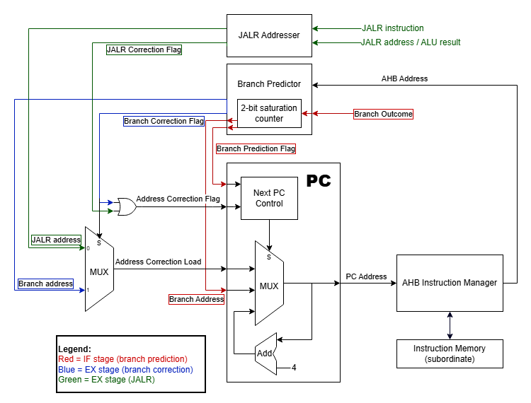

# RV32I 5-Stage Pipelined Processor Core

A 32-bit RISC-V (RV32I) processor core implemented in SystemVerilog and synthesized through the OpenLane physical design flow. The architecture is a standard 5-stage pipeline with branch prediction, data forwarding logic, hazard detection, and two AHB-Lite bus interfaces for separate data and instruction memory. The design is verified using SystemVerilog Assertions (SVA) and a directed testbench that cover edge cases.

## Architectural Highlights

* **ISA Compliance:** RV32I Base Integer Instruction Set with support for byte/halfword load/store memory operations.
* **5-Stage Pipeline Architecture:** Standard **IF** $\rightarrow$ **ID** $\rightarrow$ **EX** $\rightarrow$ **MEM** $\rightarrow$ **WB** pipeline.
* **Dual AHB-Lite Bus Interfaces (Harvard Architecture):**
  * **I-AHB Master:** Instruction memory bus utilizing the pipelined address/data phase to achieve 1 instruction per cycle.
  * **D-AHB Master:** Data memory bus utilizing the pipelined address/data phase to handle transfers for the data given by the Load-Store unit.
* **Branch Prediction:** 
  * 2-Bit Saturating Counter branch prediction (`Strongly Not Taken` $\leftrightarrow$ `Strongly Taken`).
  * No misprediction penalty for correctly predicted branches.
  * Automatic pipeline flushes on mispredictions with a two-cycle penalty.
* **Hazard Handling:**
  * **Data Forwarding Unit:** Resolves Read-After-Write (RAW) data hazards (EX $\rightarrow$ EX, MEM $\rightarrow$ EX).
  * **Hazard Detection Unit:** Identifies non-forwardable Load-Use dependencies and injects hardware stalls.
  * **X0 Register Guarding:** Suppresses writes to `x0` to maintain the zero register. 

## System Architecture

### 1. 5-Stage Core Overview


*Figure 1: RV32I 5-stage pipelined datapath featuring branch prediction, hazard handling, and AHB-Lite bus interfaces.*

* **Pipelined Datapath:** Standard 5-stage pipeline (`IF`, `ID`, `EX`, `MEM`, `WB`).
* **AHB-Lite Bus Interfaces:** Independent Instruction and Data AHB-Lite managers.
* **Decoupled Control Paths:** Separates datapath execution from local control hazard evaluation.

### 2. Branch & Jump Control Logic


*Figure 2: Branch prediction and JALR target resolution paths.*

* **2-Bit Branch Predictor:** Operates in the `IF/ID` stages using a saturating counter state machine to minimize branch penalty on correct predictions.
* **Resolution Paths:**
  * **Branch Target (EX Stage):** Evaluated in `EX` to correct branch mispredictions and limit branch misprediction penalties to 2 cycles.
  * **JALR Target (EX Stage):** Evaluated using forwarded ALU results and bit-masking before driving target selection based on correction multiplexers.

### 3. Hazard Detection & Forwarding Unit


*Figure 3: Execution stage forwarding matrix for RAW data dependencies.*

* **ALU Forwarding:** Forwards data from `EX/MEM` and `MEM/WB` pipeline registers back to the ALU input MUXes (`Forward A/B`).
* **Load-Use Stalls:** Intercepts `Load-Use` hazards by monitoring `ID/EX.MemRead` and instruction opcodes to stretch pipeline holds across multi-cycle bus transactions.

## Hardware Modules

| Module Name | Description |
| :--- | :--- |
| RV32I_subsystem | Top-level module connecting the RV32I core with the AHB-Lite bus adapters for instruction and data memory. |
| Core | Implements pipeline stages, hazard control, and branch prediction. |
| HazardDetection | Detects load-use hazards and manages pipeline stalls and bubble inserts. |
| ForwardingUnit | Determines which operand source is used for the execution stage from the register file, EX/MEM, or MEM/WB stages. |
| BranchPredictor | 2-bit saturation counter for branch prediction and execution stage branch correction for mispredictions. |
| AHBDataManager | Controls 2-cycle AHB-Lite transactions for data memory load and stores. | 
| AHBInstructionManager | Controls 2-cycle AHB-Lite transactions for instruction fetches. |
| XALU | Execution ALU supporting full 32-bit arithmetic, logical, and shift operations. | 

## Verification of Design

### Verification Strategy

The verification strategy for this RV32I pipelined core uses both **SystemVerilog Assertions (SVA)** for structural checks and a **comprehensive testbench** for instruction execution and hazard validation.

### SystemVerilog Assertions (SVA) — Structural Invariants

The `RV32I_core_sva` module runs concurrently during simulation to enforce RISC-V architectural invariants and pipeline protocol rules at every positive clock edge:

* **Architectural Invariants:**
  * **Register `x0` Hardwiring:** Asserts that any write-back targeted to register `x0` always evaluates to zero (`writeEnable_WB && rd_WB == 0 |-> registerWriteData == 0`).
  * **PC Word Alignment:** Enforces 4-byte boundary alignment on all instruction fetches (`instructionAddress[1:0] == 2'b00`).
  * **Bus Mutual Exclusion:** Ensures `memRead` and `memWrite` signals are never asserted simultaneously.
  * **Access Alignment:** Verifies that word-sized load and store operations are properly aligned.
* **Pipeline Safety & Hazard Rules:**
  * **Stall Integrity:** Guarantees that `instructionAddress` and the `ID` stage instruction register hold their values during a `pipelineStall`.
  * **Flush Execution:** Ensures pipeline flushes correctly insert a `NOP` into the `ID` stage and clear control write enables in `EX` (`writeEnable_EX == 0`).
  * **X-Propagation Detection:** Flags `$isunknown` (X/Z state) errors on register destination or write-data buses during active write-back cycles.

### Directed Testbench (`tb_comprehensive`)

The testbench drives RISC-V instruction sequences through simulated Instruction (`imem`) and Data (`dmem`) memories across dedicated execution phases:

#### Core Instruction Suite & Arithmetic Edge Cases
* **Logical & Bitwise Operations (Phase A):** Validates signed/unsigned shifts, immediate handling, and bitwise logic (`AND`, `OR`, `XOR`, `SRLI`, `SLL`).
* **Set-Less-Than Suite (Phase B):** Verifies signed vs. unsigned edge cases (`SLT`, `SLTU`, `SLTI`, `SLTIU`), specifically testing negative rollover (e.g., `-1` vs `1`).
* **Immediate & Address Generation (Phases C & S):** Tests upper immediate loading (`LUI`), program-counter offsets (`AUIPC`), address wrapping, and boundary shift operations (e.g., shifts modulo 32).

#### Pipeline Hazard & Forwarding Matrix
* **Double Forwarding (Phase D):** Tests back-to-back operations requiring simultaneous `EX->EX` bypass on both `rs1` and `rs2` registers.
* **Load-Use Hazards (Phases E & O):** Enforces a 1-cycle data stall when an instruction immediately consumes a load result, alongside multi-cycle non-stalling tests.
* **Control Hazards & Branch Logic (Phases G, H, I, P, Q, T):**
  * Verifies branch comparisons (`BEQ`, `BLT`, `BGE`, `BLTU`, `BGEU`) using previous cycle computed register data.
  * Confirms speculative fetch instruction flushing on mispredicted branches and tight loop conditions.
  * Tests ALU-to-`JALR` target calculation forwarding and branch-not-taken fallthrough execution.
* **Forwarding Suppression (Phase R):** Verifies bypass logic suppresses forwarding when source operations target register `x0`.

#### Memory Interface & Sub-Word Granularity
* **Sub-Word Access (Phases F & U):** Validates signed and unsigned byte (`LB`/`LBU`) and halfword (`LH`/`LHU`) loads alongside byte-lane masking for stores (`SB`/`SH`).
* **Return Address Verification (Phases J & K):** Checks link address saving (`PC + 4`) for `JAL` and verifies `JALR` clears the least significant bit (`LSB & ~1`) of target addresses.

#### System Robustness
* **Mid-Execution Reset (Phases M & N):** Asserts reset mid-flight during execution to ensure pipeline registers clear without introducing unknown state (`X` propagation), while preserving core state across soft resets.
* **Watchdog Timeout:** Enforces a maximum cycle limit (`#5000`) to trap unexpected infinite loops or core lockups.

## Synthesis & Implementation Metrics

### ASIC Hardening Top (`RV32I_core_asic`)

The ASIC flow uses a dedicated top, `RTL/asic/RV32I_core_asic.sv`, separate from the FPGA/UPduino top (`RV32I_subsystem`):

* **Hardened block** = RV32I core + AHB-Lite instruction and data managers (`RTL/asic/AHB*ManagerPort.sv`).
* **Both AHB-Lite buses are top-level ports** (`I_*` and `D_*`). Instruction and data memories sit outside the block, as SRAM macros would in a real SoC.
* Every architectural result is observable at a pin, so synthesis cannot remove the core as dead logic.

> **Note on earlier results:** A previous revision reported 91.71 MHz / 8,489 µm² / 1.30 mW for `RV32I_subsystem`. That top's only output (an LED) did not depend on the core, and its instruction memory had no contents at synthesis time, so most of the core was optimized away (138 flip-flops survived). Those numbers did not describe the full design and have been replaced below.

### Yosys Synthesis (generic cells, `RV32I_core_asic`)

* **Total Cells:** 9,245
* **Sequential Elements:** 1,575 Flip-Flops
  * Register file (x1–x31): 992
  * Pipeline registers, PC, branch predictor, AHB managers: 583
* **MUX cells:** 1,675

## OpenLane Physical Design & PPA Metrics

`RV32I_core_asic` was synthesized, placed, routed, and verified with **OpenLane 2 / OpenROAD** on **SkyWater 130nm (`sky130_fd_sc_hd`)**.

### Signoff Status
* **Hold Timing:** **PASS** at all corners
* **Setup Timing:** **PASS** at typical and fast corners; **FAIL at slow corner** (WNS −0.93 ns at `max_ss_100C_1v60`). Timing closure is in progress (see *Critical Path* below).
* **Routing DRC:** **CLEAN** (0 errors, resolved at detailed-routing iteration 6)
* **LVS:** **CLEAN** (0 errors)

### Performance, Power, and Area (PPA) Summary

| Parameter | Value | Details / Notes |
| :--- | :--- | :--- |
| **Technology Node** | SkyWater 130nm (`sky130_fd_sc_hd`) | High-density standard cell library |
| **Target Clock Period** | **20.00 ns** (50 MHz) | `PL/GRT_RESIZER_SETUP_SLACK_MARGIN` = 7 ns |
| **Achievable $F_{\max}$, slow corner** | **≈ 47.8 MHz** | $T_{\min} = 20.00 + 0.93 = 20.93$ ns (`max_ss_100C_1v60`) |
| **Achievable $F_{\max}$, typical corner** | **≈ 67.3 MHz** | $T_{\min} = 20.00 - 5.15 = 14.85$ ns (`max_tt_025C_1v80`) |
| **Worst Setup Slack (WNS)** | **−0.932 ns** | Corner: `max_ss_100C_1v60` |
| **Worst Hold Slack (WHS)** | **+0.105 ns** | Corner: `min_ff_n40C_1v95` |
| **Total Power** | **16.99 mW** | OpenLane default activity, 20 ns clock |
| **Die Area** | $252{,}804\ \mu\text{m}^2$ (≈ $503 \times 503\ \mu\text{m}$) | Sized from `FP_CORE_UTIL` = 40% |
| **Standard Cell Area** | $121{,}409\ \mu\text{m}^2$ | |
| **Utilization** | **51.6%** | Standard-cell area relative to core area |

### Critical Path (slow corner)

The worst path is a **combinational input-to-output path**, `I_HREADY` → `I_HADDR[30]`:

1. `I_HREADY` selects the incoming instruction (`HRDATA`) in the instruction manager.
2. The instruction is pre-decoded in IF by `BranchDecoder`.
3. `BranchAddresser` computes the branch/JAL target (PC + immediate); the adder carry chain dominates the path.
4. The target is driven out as the next fetch address on `I_HADDR`.

This is the cost of **zero-bubble branch prediction**: a fetched instruction's target is computed and issued in the same cycle it arrives. OpenLane's default I/O constraints also budget 20% of the clock for external logic at each end of the path.

**Planned fix:** predict from the IF/ID pipeline register instead of the raw bus data, so the path starts at a flip-flop. This trades one extra bubble on predicted-taken branches for a shorter clock period.

### Signoff Results

```text
[OpenROAD.DetailedRouting] DRC Errors: 0 (Resolved at iteration 6)
[LVS]                      Errors: 0
[STA] Setup WNS (ss_100C_1v60): -0.932 ns
[STA] Hold  WHS (ff_n40C_1v95): +0.105 ns
```

## Prerequisites

* **EDA Toolchain:**
  * [OpenLane 2](https://github.com/efabless/openlane2)
  * [Yosys](https://github.com/YosysHQ/yosys) with the `slang` SystemVerilog frontend (or `yowasp-yosys` via PyPI)
  * [Verilator](https://www.veripool.org/verilator/) (for linting & RTL simulation)
  * [Docker](https://docs.docker.com/desktop/setup/install/windows-install/) (for Windows distribution)
* **PDK:** SkyWater 130nm (`sky130A`)

## Build and Simulation

### Build
```bash
git clone https://github.com/briancliau/RV32I.git
cd RV32I
```

### Simulation
```bash
# Compile design and testbench
verilator --binary --timing --trace --top tb_comprehensive -f filelist.f

# Run simulation
./obj_dir/Vtb_comprehensive

# View waveform
gtkwave core_test_comprehensive.vcd
```

### Physical Layout and Signoff (ASIC)

```bash
# 1. Convert SystemVerilog RTL to plain Verilog for OpenLane
#    (only needed after RTL changes; RV32I_core_asic.v is checked in)
yosys openlane/asic/sv2v.ys

# 2. Run OpenLane
openlane --dockerized openlane/asic/config.json

# 3. View results
cd openlane/asic/runs/RUN_[date and time]/final
cat metrics.csv

# Sanity check: flip-flop count should be ~1,575
grep -cE "sky130_fd_sc_hd__(df|edf|sdf)" nl/RV32I_core_asic.nl.v
```
